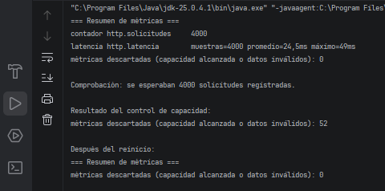

# Ejercicio 9: Sistema de Monitoreo de Métricas de Rendimiento

## Descripción

Este ejercicio implementa el patrón de diseño **Singleton** en Java para recolectar métricas de rendimiento de toda la aplicación desde un único punto.

La clase `MetricsCollector` registra contadores y tiempos de latencia, y permite exportar un resumen consolidado de las métricas recopiladas.

## Objetivos

- Aplicar Singleton para centralizar la recolección de métricas.
- Impedir la creación de instancias adicionales mediante un constructor privado.
- Registrar incrementos de contadores y tiempos de latencia.
- Permitir el registro de métricas desde varios hilos.
- Exportar un resumen de las métricas acumuladas.
- Coordinar los registros y las operaciones de reinicio para evitar inconsistencias.
- Controlar la cantidad de métricas distintas para limitar el consumo de memoria.

## Implementación del patrón Singleton

La clase `MetricsCollector` utiliza los siguientes elementos:

- **Clase interna `Holder`:** contiene la instancia estática del Singleton.
- **Constructor privado:** impide crear instancias directamente desde otras clases.
- **Método `getInstance()`:** devuelve la instancia única mediante el patrón *Initialization-on-demand Holder Idiom*.
- **Método `increment()`:** incrementa un contador identificado por su nombre.
- **Método `recordLatency()`:** registra una medición de latencia en milisegundos.
- **Método `export()`:** genera un resumen de las métricas acumuladas.
- **Método `exportAndReset()`:** exporta el resumen y limpia las métricas registradas.

La instancia se crea de forma perezosa y segura entre hilos cuando se solicita por primera vez.

## Propósito de las clases del ejercicio

- **`MetricsCollector`:** centraliza la recolección, el control de capacidad y la exportación de métricas.
- **`LatencyStats`:** almacena la cantidad de muestras, el tiempo total y la latencia máxima, sin conservar cada medición individual.
- **`Main`:** simula varios interceptores de red mediante hilos concurrentes y comprueba el registro de métricas, el límite de capacidad y el reinicio.

## Conceptos clave

El ejercicio combina Singleton con estructuras de concurrencia de Java, como `ConcurrentHashMap` y `LongAdder`, para gestionar las métricas compartidas.

`LongAdder` permite acumular valores con menor contención en escenarios con múltiples hilos. `ConcurrentHashMap` facilita el acceso concurrente a las colecciones.

Además, se establece un máximo de **100 métricas distintas**. Cuando se alcanza ese límite, los nuevos nombres de métricas se rechazan y se contabilizan como descartados.

La operación `exportAndReset()` genera un resumen y limpia los datos para permitir que comience un nuevo ciclo de recolección. La coordinación de esta operación con los registros es importante para evitar inconsistencias durante el reinicio.

## Resultado

## Conclusión

Este ejercicio demuestra cómo el patrón Singleton puede centralizar la recolección de métricas de rendimiento y combinarse con herramientas de concurrencia para gestionar registros compartidos.

También permite comprender la importancia de limitar el número de métricas, evitar el almacenamiento innecesario de muestras individuales y coordinar correctamente las operaciones de exportación y reinicio.
